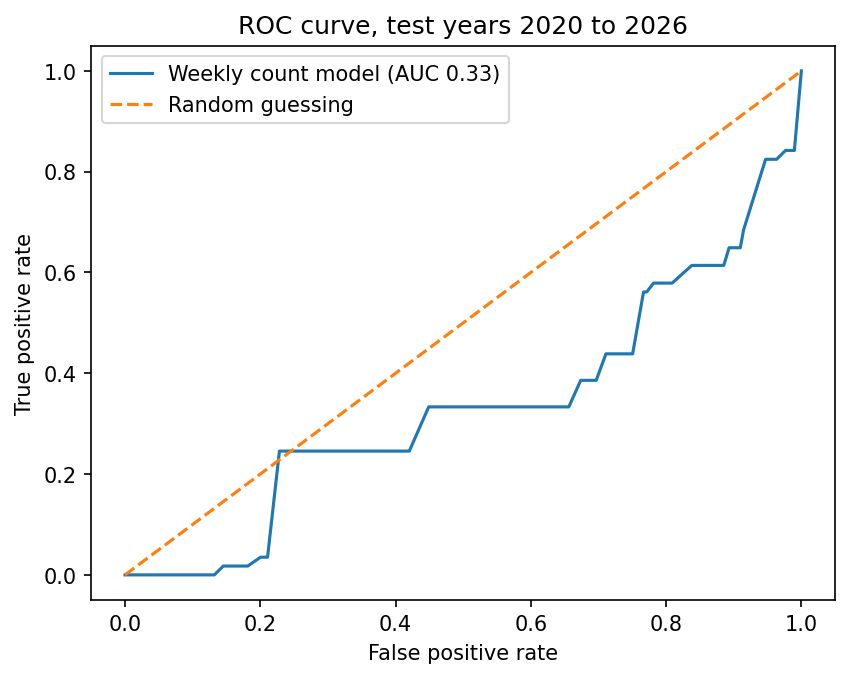
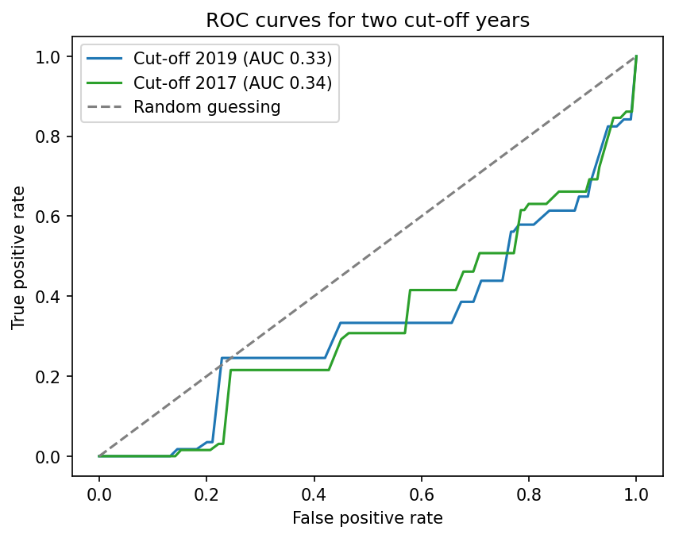

# Flood Warnings Classifier

A classifier that tests whether historic warnings can predict severe flood warnings in England, and reports where the models fail. It was built as a learning project for ML and MLOps.

## Problem and audience

The Environment Agency issues three levels of flood warning: Flood Alert, Flood Warning, and Severe Flood Warning. Severe warnings carry a danger-to-life risk and are rare. Being able to flag them early, or to understand which patterns come before them, would help emergency planners and anyone who needs to judge flood risk in their area.

This project is for people learning applied machine learning and MLOps, and for reviewers who want to see a complete, evaluated workflow on a real public dataset, including a result that doesn't work.

## Data and licence

The data is the Historic Flood Warnings log published by the Environment Agency, covering warnings issued from January 2006 to June 2026 (Approval for Access reference AfA435). The file used is the EA-only spreadsheet, `tblAllData`, with 85,993 rows and five columns: date, area, code, warning area name, and type.

The data is published under the Open Government Licence v3.0. The project contains no personal data.

## Method

### Target and split

The target is whether a new warning is severe (1) or another level (0). Only new Flood Alert, Flood Warning, and Severe Flood Warning rows are kept, after normalising case. Training uses warnings up to 2019, and testing uses 2020 onwards, which gives 57 severe warnings in the test years, the most of any cut-off tested.

### Baseline

A model that always predicts "not severe" scores 99.9% accuracy but a severe F1 of 0.0. That's the reference any real model has to beat.

### Handling update rows

The log contains two kinds of row: new warnings and update rows (Update Flood Alert, Update Flood Warning, Update Severe Flood Warning). Update rows record changes to an existing warning, so one flood event can appear several times.

For the current target, update rows are excluded. An update is written after the original warning, so an "Update Severe Flood Warning" row reveals the label the model is trying to predict. Training on it would give the model hindsight and inflate the score.

The data itself is valuable, and this exclusion is a deliberate test choice rather than a judgement that updates are unimportant. Deliberately withholding them tests whether the model can predict severity from information available when a warning is first issued. Earlier updates can still be used as input features, computed only from data before each date, which is the next experiment.

## Results

| Feature | Test years | AUC | Severe F1 |
|---|---|---|---|
| Always predict not severe (baseline) | 2020 to 2026 | n/a | 0.0 |
| Area and month (logistic regression) | 2020 to 2026 | not measured | 0.0 |
| Area history rate | 2020 to 2026 | 0.451 | 0.0 |
| Weekly warning count (previous week) | 2020 to 2026 | 0.334 | 0.002 |

The weekly-count result is also shown in the ROC curve under Known weaknesses. A cut-off comparison in the notebook shows the result holds across split years: 2017 gives AUC 0.34 and 2019 gives AUC 0.33.

### 30-day target

The per-warning target proved hard to predict, so the question was reframed: does a severe warning start in a given area within the next four weeks? Features use only data from earlier weeks, computed on the ten most frequent areas, with the same 2019 cut-off.

| Measure | Test years (2020 to 2026) |
|---|---|
| Baseline severe F1 (always predict no) | 0.0 |
| Model AUC | 0.729 |
| Model severe F1 (threshold 0.5) | 0.043 |

The AUC shows the model ranks weeks with a severe warning above quiet weeks about 73% of the time, well above chance. The F1 is modest because the default threshold of 0.5 flags few weeks correctly. The threshold has not been tuned on the test years. The test set holds only 31 positive weeks, so the AUC should be read with a margin of error.

## Known weaknesses

ROC curve for the weekly warning-count model on the 2020 to 2026 test years. The curve falls below the diagonal (AUC 0.33), so the feature ranks severe warnings below ordinary ones on this split.

ROC curves for the weekly-count model at cut-offs of 2017 and 2019. Both sit below the diagonal, so the result doesn't depend on the chosen year.

- **No feature beats chance so far.** Area and month, area history, and the weekly warning count all scored at or below an AUC of 0.5 on the 2020 to 2026 test years.
- **Few severe examples in the test set.** 57 severe warnings is enough to show a pattern, but not to support a firm conclusion. A single case can move the scores noticeably.
- **Missing drivers.** Severity depends mainly on rainfall and river levels, which aren't in this dataset, so predicting severity from warning history alone is a hard problem.

## Next steps

- **Reframe the target as a 30-day forecast.** Predict whether a severe warning occurs in an area within the next 30 days, using only information available before each date. This is a more realistic question for a flood-risk team.
- **Use earlier updates as features.** Count recent updates in each area and whether an earlier warning was upgraded, computed only from data before each date.
- **Track experiments in MLflow.** Log each feature test, its cut-off year, AUC, and F1 in one place, as the RAG project does.
- **Add a regression gate.** A GitHub Actions workflow that re-runs the evaluation on each push and fails if the AUC drops below a set threshold.

## Regression gate

A GitHub Actions workflow (`.github/workflows/regression-gate.yml`) runs on every push. It downloads the pinned dataset release `data-v1`, rebuilds the weekly-count feature, and checks the test-year AUC against a threshold of 0.30. The build fails if the AUC falls below that value.

The dataset is pinned to a release so that any change in the AUC comes from the model, not from the data changing. The current AUC is 0.334.

## How to run

The project runs in Google Colab, with no local installation or cloud account needed.

1. Open `flood_warnings_classifier.ipynb` in Colab.
2. Upload `Historic_Flood_Warnings.zip` to the `/content` folder, using the upload icon in the Files panel.
3. Run the cells in order from section 1. The unzip step extracts the spreadsheet into `flood_data`.
4. Sections 7 and 10 set the split and compare cut-offs. Section 9 and the sub-sections train the models.

Colab sessions reset, so re-upload the zip and rerun from section 1 if you return later.
